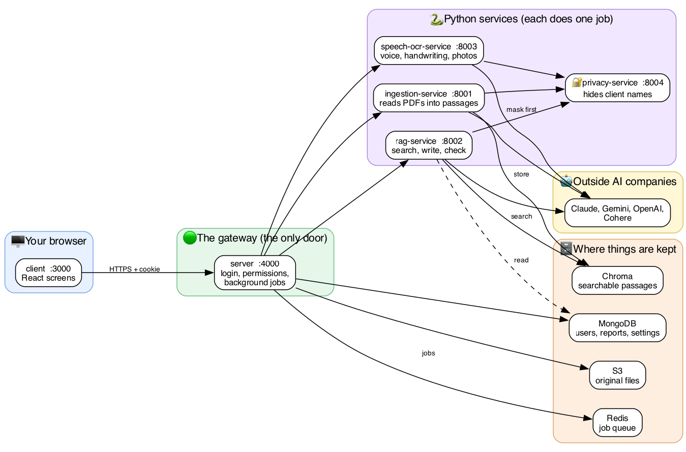
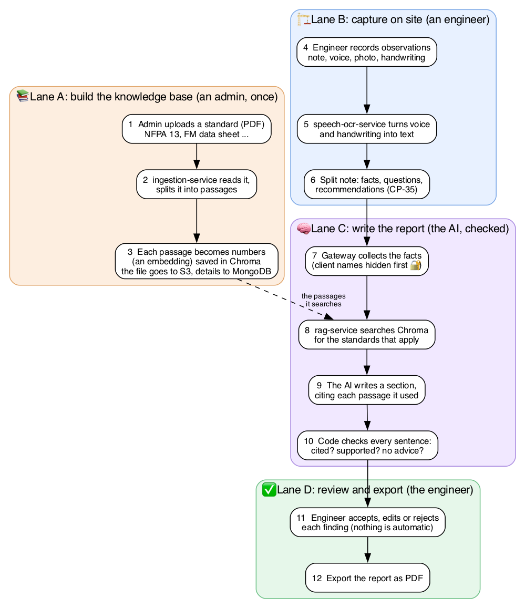

# A2603: AI Risk Report Generator

Capstone project (A2603) for Marsh Singapore. Engineers record what they see on a site visit (notes, voice, photos). An AI drafts a risk report from those observations and a library of standards, and **every sentence it writes must cite the passage it came from**. The engineer reviews and accepts each finding. Nothing is automatic.



## The six services (start here, then go deeper)

Each service has its own README. Read the one you need; you do not need all six.

| Service | Job in one line | Tech | Port | README |
|---|---|---|---|---|
| `client` | The screens engineers and admins use | React, Vite, TypeScript | 3000 | [client/README.md](client/README.md) |
| `server` | The gateway: login, permissions, data, background jobs | Node, Express, TypeScript | 4000 | [server/README.md](server/README.md) |
| `ingestion-service` | Reads standards (PDFs) into searchable passages | Python, FastAPI | 8001 | [README](microservices/ingestion-service/README.md) |
| `rag-service` | Searches, drafts report text, checks every statement | Python, FastAPI | 8002 | [README](microservices/rag-service/README.md) |
| `speech-ocr-service` | Turns voice, handwriting and photos into text. Stores nothing | Python, FastAPI | 8003 | [README](microservices/speech-ocr-service/README.md) |
| `privacy-service` | Hides client names before any text goes to an outside AI | Python, FastAPI | 8004 | [README](microservices/privacy-service/README.md) |

Data stores: **MongoDB** (users, reports, settings), **Chroma** (searchable passages), **S3** (original files), **Redis** (background job queue).

## How a report gets made



Four hard rules shape the code (the full list is in [CLAUDE.md](CLAUDE.md)):

1. Text with client details goes to an outside AI **only after privacy-service hides them**. If hiding fails, nothing is sent.
2. Review decisions and report versions are **append-only**: never edited, never deleted.
3. Route handlers in `server/src/routes/` **never touch the database directly**; they call services.
4. An AI answer reaches the screen **only after code has checked each sentence**.

## Where to read next

| You want to... | Read |
|---|---|
| Run it | [Running the stack](docs/RUNNING.md) and the section below |
| Understand one service | Its README (table above) |
| Understand the database or the vector index | [docs/areas/database.md](docs/areas/database.md) |
| Understand how services work inside | [docs/areas/services.md](docs/areas/services.md) |
| Understand how client text is protected | [docs/areas/privacy.md](docs/areas/privacy.md) |
| Deploy to AWS | [docs/areas/cloud.md](docs/areas/cloud.md) |
| Build a screen | [UI conventions](docs/areas/ui.md) and the [design system](docs/design-system-v2.md) |
| See why something was decided | [docs/DECISIONS.md](docs/DECISIONS.md) |
| Set up Cohere and Chroma | [docs/COHERE_CHROMA.md](docs/COHERE_CHROMA.md) |

This README must reflect the current architecture. If a PR changes what is true here, update this file in the same PR.

## Running the stack locally

One `.env.example` covers both run modes — pick one per session, don't mix them
for the same service.

### Client with a local gateway

```sh
npm --prefix server ci
npm --prefix server run seed   # sample accounts, password `password123`
npm --prefix server run dev
npm --prefix client ci
npm --prefix client run dev
```

Open `http://localhost:3000` and sign in as a seeded account, e.g.
`alex.rowe@example.com` (risk engineer) or `sana.patel@example.com` (knowledge
admin), with the dev password `password123`.

### Docker

Start the services, MongoDB, and Chroma (the full stack needs 5 to 7 GB of RAM; on a small laptop use the light stack in [docs/RUNNING.md](docs/RUNNING.md)):

```sh
cp .env.example .env   # fill in the real values
docker-compose up --build
```

### Manual services

Use one terminal per service. Copy `.env.example` to `.env` in each backend
service's own directory (`server/.env`,
`microservices/rag-service/.env`, etc.), fill in real values, then run each service's own
dev command: `npm run dev` for client/server, or
`uvicorn app.main:app --reload --port <port>` for the Python services.

See [Running the stack](docs/RUNNING.md) for the full setup instructions.

### Service URLs and health checks

`.env.example`'s `*_SERVICE_URL` vars default to `localhost`, which is what
the manual run mode needs. Docker instead needs Docker service names
(`http://rag-service:8002`) — `docker-compose.yml` overrides those three vars
for the `server` container automatically, so the same `.env` file works
either way without editing. See `CLAUDE.md` "Known pitfalls" for why.

The Python services expose `http://localhost:<port>/health`. The gateway exposes
`http://localhost:4000/api/health`, and the client opens at `http://localhost:3000`.

## Branch and commit convention

- Branches: `feature/<initials>-<story-id>` (e.g. `feature/cg-F-01`)
- Commits must reference the story ID: `feat(F-01): init repo`

This README must reflect the current architecture. If a PR changes what is true here, update this file in the same PR — not later.
