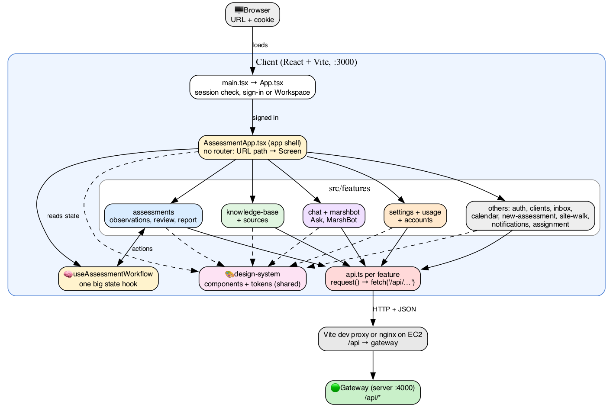

# Client

## What it is

The browser app (React 19, Vite, TypeScript, port 3000) where engineers and knowledge admins sign in, run assessments, review reports, manage the knowledge base and talk to MarshBot.

## Where it sits



- It talks to one thing only: the gateway (`server`, :4000), through paths that start with `/api`.
- It holds no database and no AI keys. The gateway decides who may do what (HTTP 403); the client only hides what a role cannot use.
- In development Vite serves it and proxies `/api`. On EC2 it is a static build served by host nginx.

## How a screen gets its data

1. A **screen** (a file in a feature's `screens/` folder) renders and asks for data.
2. It gets the data from a **hook** (a function that gives a component state or data, e.g. `useInbox`, `useOfis`) or from the big workflow hook.
3. The hook calls a function in that feature's **`api.ts`** (for example `listAssessments`).
4. `api.ts` calls `request()` (in `features/assessments/api.ts`), which runs `fetch('/api/...')`. It parses JSON, turns a 401 into a "session ended" event and a 502/504 into a `GatewayError`.
5. The browser sends the request to the dev proxy (or nginx), which forwards it to the gateway.
6. The gateway answers; the hook stores it and the screen redraws.

## Folders and key files

The tree below shows where the main folders and files sit; the table explains each.

```text
src/
├── main.tsx                   # starts React
├── App.tsx                    # session check, sign in or workspace
├── features/                  # one folder per screen area
│   ├── assessments/           # the core
│   │   ├── AssessmentApp.tsx  # shell
│   │   ├── api.ts             # API calls
│   │   ├── screens/           # Dashboard, Overview, Review, ...
│   │   ├── ask/               # ask about a passage
│   │   ├── comments/          # comment threads
│   │   ├── document/          # editor and export
│   │   └── generation/        # drafting runs
│   ├── auth/                  # sign-in, idle timeout
│   │   └── access.ts          # screen paths and role permissions
│   ├── new-assessment/        # create-assessment form
│   ├── site-walk/             # record a site walk
│   ├── knowledge-base/        # admin documents, review
│   ├── sources/               # shows a cited passage
│   ├── chat/                  # Ask screen, PDF viewer
│   ├── marshbot/              # threads, cards, details
│   ├── clients/               # client list and page
│   ├── inbox/                 # items to do
│   ├── notifications/         # bell, list, counts
│   ├── calendar/              # surveys and due dates
│   ├── assignment/            # choose the engineer
│   ├── accounts/              # user accounts (admin)
│   ├── settings/              # settings screens
│   └── usage/                 # usage and cost screen
├── design-system/             # shared look and controls
│   ├── components/            # ai, core, display, feedback, ...
│   ├── tokens/                # colours, spacing, type, motion
│   └── index.ts               # the one import point
└── test/                      # test setup
    ├── setup.ts               # mocks sign-in
    └── session.ts             # test sessions
```

All paths are under `client/src/`.

| Path                        | Job                                                                                                                                                                                                                                   |
| --------------------------- | ------------------------------------------------------------------------------------------------------------------------------------------------------------------------------------------------------------------------------------- |
| `main.tsx`                  | Starts React and mounts `App`.                                                                                                                                                                                                        |
| `App.tsx`                   | Checks for a saved session, shows `SignIn` or the `Workspace`, ends the session on a 401 event, signs out.                                                                                                                            |
| `features/assessments/`     | The core. Shell (`AssessmentApp.tsx`), the workflow hook, `api.ts`, `screens/` (Dashboard, Overview, Checklist, Observations, Review, ReviewWorkspace, exports), `ask/`, `comments/`, `document/` (editor and export), `generation/`. |
| `features/auth/`            | Sign-in, set-password, idle timeout, and `access.ts` (screen paths and role permissions).                                                                                                                                             |
| `features/new-assessment/`  | The create-assessment form and client intake.                                                                                                                                                                                         |
| `features/site-walk/`       | Record a site walk: capture, pending uploads, proposals.                                                                                                                                                                              |
| `features/knowledge-base/`  | Knowledge base for admins (documents, review, manual standards) and read-only for engineers.                                                                                                                                          |
| `features/sources/`         | Shows a cited passage (text, math, page region). Reused wherever a citation appears.                                                                                                                                                  |
| `features/chat/`            | The Ask screen (knowledge assistant), PDF viewer, OpenUI rendering.                                                                                                                                                                   |
| `features/marshbot/`        | MarshBot: threads, cards, details panel.                                                                                                                                                                                              |
| `features/clients/`         | Client list and client page.                                                                                                                                                                                                          |
| `features/inbox/`           | Inbox of items to do.                                                                                                                                                                                                                 |
| `features/notifications/`   | Bell, list, and the counts context (one poller).                                                                                                                                                                                      |
| `features/calendar/`        | Surveys and report due dates by month or week.                                                                                                                                                                                        |
| `features/assignment/`      | Choose which engineer an assessment is assigned to.                                                                                                                                                                                   |
| `features/accounts/`        | User accounts screen (admin).                                                                                                                                                                                                         |
| `features/settings/`        | Settings screens.                                                                                                                                                                                                                     |
| `features/usage/`           | Usage and cost screen (charts, lazy-loaded).                                                                                                                                                                                          |
| `design-system/components/` | Shared controls in folders `ai`, `core`, `display`, `feedback`, `forms`, `navigation`.                                                                                                                                                |
| `design-system/tokens/`     | CSS variables: colours, spacing, type, motion, elevation, fonts.                                                                                                                                                                      |
| `design-system/index.ts`    | The one place features import shared components from.                                                                                                                                                                                 |
| `test/`                     | `setup.ts` (mocks sign-in for every test) and `session.ts` (test sessions).                                                                                                                                                           |

## How screens are chosen

There is no router library. The URL path is the router, done by hand:

1. `auth/access.ts` holds `SCREEN_PATHS` (screen name to path, e.g. `dashboard` is `/assessments`) and `screenForPath(path, session)`. Unknown paths and `/` open the role's home screen.
2. `useAssessmentWorkflow` starts its state from `screenForPath(window.location.pathname)`, plus `?ref=&tab=&obs=` from the query string.
3. When the state changes, the hook calls `history.pushState` or `replaceState`. A `popstate` listener (Back and Forward) reads the URL back into state.
4. `AssessmentApp.tsx` looks at that state and renders the matching screen. `KnowledgeAssistant` and `UsageCosts` are loaded with `lazy()` on first open.
5. A route guard uses `can()` from `auth/access.ts`; blocked screens show `AccessDenied`.

## State

- No Redux. State is React `useState` inside hooks.
- `useAssessmentWorkflow` (`features/assessments/useAssessmentWorkflow.tsx`, about 4,900 lines) is called once, in `App.tsx`'s `Workspace`, and passed down as `v` to `AssessmentApp`. It owns the screen, tab, open assessment, observations and more.
- Smaller hooks sit beside it (`useObservations`, `useReview`, `useSections`, `useOfis` and others in `features/assessments/`).
- Notification counts live in a context provider above all screens (`NotificationCountsContext.tsx`).
- MarshBot threads are cached in memory; `App.tsx` clears the cache on sign-out.
- `zustand` is in package.json but no source file imports it (see the audit).

## Design system

`src/design-system/` holds the shared controls (Button, Input, Select, Dialog, Table, Tabs, SideNav, Toaster and more) and CSS tokens. Rule: import from `design-system` (`index.ts`), reuse an existing component before making a new one, and colour only with the CSS variables. A control that knows its domain stays in its feature folder. Look and feel rules are in `docs/areas/design-system-v2.md`.

## Configuration

- `SERVER_URL`: where the Vite dev server forwards `/api`. Order: shell value, then `client/.env.development` (copy `client/.env.example`), then `http://localhost:4000`.
- `import.meta.env.DEV` is the only Vite env flag the code reads (in `chat/components/pdfSetup.ts`). No `VITE_*` variables are read.
- `vite.config.ts` proxies `/api` with `changeOrigin: true`.
- EC2 differs: there the client is a static build (`npm run build`) served by host nginx, so Vite's proxy does not exist. If you add a proxied path in `vite.config.ts`, add a matching `location` to the nginx config in `docs/areas/cloud.md`.
- In Docker, `SERVER_URL` is set to the Docker service name by `docker-compose.yml`.

## Run and test

All from `client/`:

| Command              | Does                                                         |
| -------------------- | ------------------------------------------------------------ |
| `npm run dev`        | Vite dev server on :3000, using `SERVER_URL`                 |
| `npm run dev:local`  | Same, but ignores `.env.development`, so uses localhost:4000 |
| `npm run build`      | `tsc -b` then `vite build`                                   |
| `npm run lint`       | ESLint                                                       |
| `npm run format`     | Prettier write                                               |
| `npm test`           | Vitest once (jsdom)                                          |
| `npm run test:watch` | Vitest watch                                                 |

Tests: Vitest plus Testing Library, files named `*.test.ts(x)` next to the code. `src/test/setup.ts` mocks the auth calls so every test signs in without a gateway. Tests stub `fetch` (see `features/auth/idleTimeout.test.tsx`). Test timeout is 20 s because full-app tests are slow.

## Gotchas

- `useAssessmentWorkflow.tsx` is about 4,900 lines. Search it, do not read it top to bottom.
- Very large files: `assessments/api.ts` (1,701 lines), `components/ChecklistItems.tsx` (1,182), `screens/ReviewWorkspace.tsx` (1,078), `ask/AskPanel.tsx` (1,060).
- Not all gateway calls go through `request()`. Several `api.ts` files have their own `fetch` code (see the audit).
- Do not add a router library; paths live in `auth/access.ts`.
- Do not add the `commentAnchor` mark to the document editor extensions, and do not poll for MarshBot (server-sent events push to Overview). Both are in `CLAUDE.md`.
- `res.json` in `client/` is a tracked test-result dump, not app code.
- The `/api` proxy only exists in dev. A new proxied path needs the nginx change too.
- Always restart the `client` container after a branch switch (file events do not reach Docker on macOS).

## Deeper docs

- [UI conventions](../docs/areas/ui.md)
- [Design system v2](../docs/areas/design-system-v2.md)
