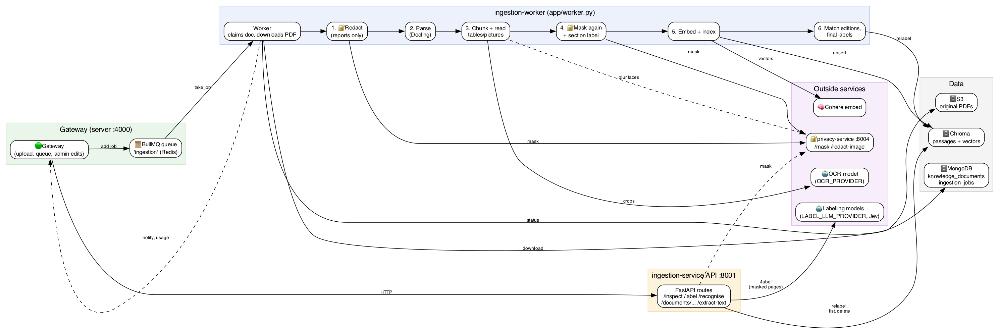

# Ingestion service

A FastAPI service (port `8001`) plus a queue worker that turns uploaded standards and past reports (PDFs) into searchable, labelled passages in Chroma.

## Where it sits



- The gateway (`server`) calls the HTTP API for quick jobs (inspect, label, OCR a screenshot, relabel, match, browse passages) and queues the slow job (ingest a PDF) on the BullMQ `ingestion` queue in Redis.
- `ingestion-worker` (same image, `python -m app.worker`) takes one job at a time and runs the pipeline. Only the worker needs Redis, S3 and the full parse stack.
- It calls privacy-service (masking), Cohere (embeddings), an OCR model and labelling models (paid APIs), and reads/writes Chroma, MongoDB and S3.

## How a document becomes searchable

Code order in `app/worker.py` and `app/pipeline/__init__.py` (`run`):

1. Claim: the worker atomically sets the `knowledge_documents` record from `queued` to `processing`, then downloads the PDF from S3.
2. Ask the gateway how to protect it (`privacy.for_document`). If it cannot answer, the document fails (fail closed).
3. Redact (stage `anonymising`): only when protection is on and the type is not a standard. `redactor.redact_pdf` masks client details through privacy-service `/mask` and redraws the pages.
4. Parse (stage `parsing`): `parser.parse` runs Docling (OCR for scanned pages).
5. Chunk (stage `chunking`): `chunker.chunk` builds passages. Tables, formulas and pictures are cropped and read by the `OCR_PROVIDER` model (faces blurred first when protected).
6. Safety net and section: `anonymiser.anonymise` masks chunk text once more; labels are added to each passage; a report's `section` comes from its fonts (`sections.py`).
7. Index (stage `indexing`): `indexer.index_chunks` splits oversized text, embeds with Cohere (`embedder.embed`), upserts to Chroma in batches of 300. Passages go in as `needs_review`.
8. Match: `matching.find_match` looks for a copy or another edition among stored documents.
9. Relabel to the final status (`active` or `needs_review`) and save `complete`. On failure the worker deletes the partial passages and saves a plain reason. Then it tells the gateway (`notifications.py`) and posts AI-call usage (`usage.py`).

## Folders and key files

| Path | Job |
|---|---|
| `app/main.py` | FastAPI app; warms the OCR converter in a background thread unless `PRELOAD_OCR=0` |
| `app/api/routes.py` | All HTTP endpoints and request models |
| `app/worker.py` | BullMQ worker: claim, run, record outcome, cancel, `labels()` and `relabel_passages()` |
| `app/pipeline/__init__.py` | `run()`: chains the stages; lazy `parse` / `chunk` |
| `app/pipeline/redactor.py`, `anonymiser.py` | Redact the PDF before parsing; mask chunk text after |
| `app/pipeline/parser.py`, `ocr_config.py`, `columns.py` | Docling parse, OCR engine choice, column order |
| `app/pipeline/chunker.py` | Passages from the parse (largest file) |
| `app/pipeline/chunking_helper/` | Table, formula and picture readers; `ocr_model.py` picks the provider (`anthropic_ocr.py`, `gemini_ocr.py`, GLM); `rate_limit.py`, `image_crop.py` |
| `app/pipeline/embedder.py`, `indexer.py` | Cohere embedding with rate-limit pacing; Chroma upsert, relabel, delete |
| `app/pipeline/sections.py`, `progress.py`, `errors.py` | Report sections from fonts; stage progress to `ingestion_jobs`; error types |
| `app/labelling/` | Reads type, title, edition, date, jurisdiction, facility (`/label`) |
| `app/matching.py`, `app/outline.py` | Copy / edition matching, passage listing and comparison; outline counts |
| `app/manual.py` | Clauses of a manually entered standard (IN-18) |
| `app/extract_text.py` | Plain text from PDF, Word, email (CP-23) |
| `app/privacy.py`, `app/usage.py`, `app/notifications.py` | privacy-service client; AI-call usage; gateway notifications |
| `app/retrieval_config.py` | Cohere and Chroma clients, collection name (shared contract with rag-service) |
| `eval/`, `tests/` | Evaluation scripts; pytest suite |

## Endpoints

| Method and path | What it does | Who calls it |
|---|---|---|
| `GET /health` | Liveness | Docker / gateway |
| `POST /inspect` | Opens the PDF, returns page count or 422 | Gateway, before storing |
| `POST /label` | Reads the PDF's details with models (masked when protected) | Gateway, at upload |
| `POST /extract-text?filename=` | Plain text from PDF, docx, eml, msg | Gateway (client intake) |
| `POST /recognise` | OCR one manual-clause screenshot | Gateway (manual entry) |
| `PUT /documents/{id}/labels` | Rewrite labels on all passages, no re-embedding | Gateway |
| `POST /documents/{id}/match` | Re-check copy / edition, relabel | Gateway |
| `PUT` / `DELETE /documents/{id}/manual-sections/{sid}` | Index or remove one clause | Gateway |
| `GET /documents/{id}/clauses` | Group a document's text into clauses | Gateway |
| `GET` / `DELETE /documents/{id}/passages` | List (paged, filtered) or delete passages | Gateway |
| `GET /documents/{id}/comparison/{other}` | Two documents side by side | Gateway |
| `POST /index` | Dev endpoint: index pre-anonymised chunks | Tests only (not verified: no gateway caller found) |
| `POST /ingest` | Stub, returns `queued` and does nothing | Tests only |
| `GET /` | Returns `{"test": "test"}` | Nobody |

## Data it reads and writes

- MongoDB: reads and updates `knowledge_documents` (status, `match`, `result`, `privacyMapping`); writes `ingestion_jobs` (stage log, progress, privacy counts). Schema: docs/areas/database.md.
- Chroma: one collection, named from `CHROMA_COLLECTION`, `EMBEDDING_MODEL` and 1024 dimensions (`app/retrieval_config.py`). Writes passages and vectors, relabels, deletes.
- S3: reads the original PDF. Never writes it.
- Redis: only the BullMQ `ingestion` queue (worker).
- Gateway: posts notifications and AI-call usage; reads each document's privacy settings.

## Configuration

Names only; see `.env.example`.

- Core: `MONGODB_URI`, `REDIS_URL`, `S3_BUCKET`, `AWS_REGION`, `GATEWAY_URL`, `SERVICE_API_KEY`
- Embedding and Chroma: `COHERE_API_KEY`, `EMBEDDING_MODEL`, `CHROMA_MODE`, `CHROMA_HOST`, `CHROMA_PORT`, `CHROMA_COLLECTION`, `CHROMA_CLOUD_HOST` (and `CHROMA_API_KEY`, `CHROMA_TENANT`, `CHROMA_DATABASE` for cloud)
- OCR: `OCR_PROVIDER`, `OCR_MODEL`, `OCR_CONCURRENCY`, `OCR_RENDER_DPI`, `ANTHROPIC_API_KEY`, `GEMINI_API_KEY`, `GLMOCR_OCR_*`, `GPU_ENABLED`, `DOCLING_DOCUMENT_TIMEOUT`, `PRELOAD_OCR`
- Labelling: `LABEL_CLASSIFIER`, `LABEL_LLM_PROVIDER`, `LABEL_LLM_MODEL`, `LABEL_PAGES`, `LABEL_MIN_CONFIDENCE`, `OPENAI_LABEL_API_KEY`
- Matching: `MATCH_MIN_SHARE`, `MATCH_PASSAGE_SIMILARITY`
- Privacy: `PRIVACY_SERVICE_URL`, `PRIVACY_TIMEOUT`, `PRIVACY_SECONDS_PER_1000_CHARS`

## Run and test

Docker commands run from the repository root; the rest from this folder. Needs Python 3.11+ and [uv](https://docs.astral.sh/uv/).

```
uv sync                                                         # install
docker compose --profile local-db up -d chroma                  # local Chroma (skip with CHROMA_MODE=cloud)
uv run uvicorn app.main:app --host 0.0.0.0 --port 8001 --reload # API
uv run python -m app.worker                                     # worker (needs Redis: docker compose up -d redis)
docker compose up -d                                            # whole stack
docker compose -f docker-compose.yml -f docker-compose.local-ocr.yml up -d   # self-hosted GLM-OCR (Ollama)
uv run pytest                                                   # default suite (skips slow, inspect, model, e2e, chroma, live)
uv run pytest -m "not slow or slow"                             # everything; add --real-ocr for real OCR (costs money)
uv run pytest -m chroma                                         # needs local Chroma
uv run pytest -m live -s tests/test_ocr_live.py                 # paid OCR call
docker compose --profile test run --rm --build ingestion-test   # suite in Docker
```

## Evaluation scripts

`eval/` holds three by-hand evaluations (paid calls, not in CI), each with `golden`/scoring code and dated `results/` reports:

- `eval/labelling/run_eval.py`: `uv run python -m eval.labelling.run_eval [--split tune|test|all] [--privacy]`
- `eval/ocr/run_eval.py`: `uv run python -m eval.ocr.run_eval [--providers anthropic,glm]` (tables on the FM-200 PDF)
- `eval/matching/run_eval.py`: `uv run python -m eval.matching.run_eval` (runs inside the worker container; uses its own Chroma collection)

## Gotchas

- Slow work belongs to the worker, not the API. `POST /ingest` does nothing.
- Passages are indexed as `needs_review` and flipped at the end, so a half-ingested document is never searchable.
- `worker.labels()` must match `labels()` in `server/src/services/knowledge-document.service.ts`.
- `EMBEDDING_MODEL` is part of the Chroma collection name: a new model starts an empty collection.
- Fail closed: if privacy-service or the gateway does not answer, the document fails and nothing is indexed.
- Inside Docker use service names; local runs use `localhost` (docker-compose.yml overrides the URLs).
- Cohere trial limits: `embedder.py` paces and splits batches and can wait minutes.
- Chroma Cloud caps: 300 records per write/read, 16 KB per stored document (`indexer.py`).
- Standards are not redacted; if a report is typed as a standard it is sent unmasked.

## Deeper docs

- docs/areas/services.md: "Knowledge document ingestion (IN-01)", "Automatic labelling (IN-05)", "Matching: duplicates and newer editions (IN-07)", "Correcting a knowledge document (KB-01)", "Browsing a knowledge document's passages (IN-17)", "Entering a standard by hand (IN-18)", "Client intake" (`POST /extract-text`)
- docs/areas/privacy.md: "Ingestion of past reports (PV-05)", "Scanned pages, pictures and the safety net (PV-06)", "Known gaps"
- docs/areas/database.md: "Knowledge documents (IN-01, KB-01, IN-07)", "Ingestion jobs (`ingestion_jobs`)", "AI-call usage (EV-03)"
- docs/COHERE_CHROMA.md: Cohere and Chroma setup, limits
