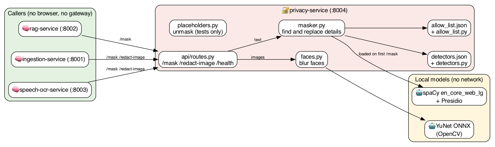

# Privacy service

A small FastAPI service (port `8004`) that replaces client details in text with placeholders (`[PERSON_1]`) and blurs faces in photos, all locally, before anything goes to an external AI.

## Where it sits



- Callers are other services, not the browser or the gateway: rag-service, ingestion-service and speech-ocr-service each have an `app/privacy.py` that posts to it. (A search of `server/src` finds no call to port 8004.)
- It calls nothing outside the service. Its models (spaCy and YuNet) run locally, so what it reads never leaves the network.
- It stores nothing. Each request is answered from the text or images in it.

## How it works

Masking (`POST /mask`):

1. A caller sends `texts`, optional `known_entities` (client, site, people it already knows), an earlier `mapping`, and optional `detect` (`CLIENT`, `SITE`).
2. `masker.mask` finds details per text: known names first, then hand-written patterns (UEN, postal code, address, vehicle plate), then Presidio and spaCy for names, phone numbers, emails and NRIC/FIN.
3. A found phone number, NRIC or UEN counts only if a label word ("tel", "nric") sits shortly before it, or it is written like a phone number (`+65`, space, dash). A vehicle plate counts only if its check letter is right.
4. `allow_list.json` words and `detectors.json` switches remove false hits. Where two hits overlap, the surer one wins.
5. Each detail becomes a typed placeholder. The same detail gets the same placeholder across the request, because the `mapping` is passed back and forth.
6. The reply has `texts`, the full `mapping` (placeholder to real text) and `spans` (where each detail sat in the input).

Face blur (`POST /redact-image`): each base64 image is decoded, YuNet finds faces on a copy at most 960 px long, and each face is pixelated then blurred at full size (`app/faces.py`). A photo with no face comes back unchanged.

Unmasking is not an endpoint. Callers put the real text back themselves with their own copy of `placeholders.unmask`.

## Folders and key files

| Path | Job |
|---|---|
| `app/main.py` | Creates the app. Reads `detectors.json` and `allow_list.json` at start, so a typo stops the service. |
| `app/api/routes.py` | `/health`, `/mask`, `/redact-image` and their request models. |
| `app/masker.py` | The masking engine: patterns, label checks, Presidio/spaCy, overlap rules, placeholder numbering. Largest file. |
| `app/faces.py` | `blur_faces`: YuNet detection, pixelate, blur. |
| `app/detectors.py` | Which detail kinds are on (`detectors.json`). |
| `app/allow_list.py` | Words and names that are never masked (`allow_list.json`). |
| `app/placeholders.py` | `unmask` for a mapping. Used by tests only inside this service. |
| `app/models/` | The YuNet `.onnx` file, kept in the repo (about 230 KB). |
| `detectors.json` | On/off switch for each kind: `PERSON`, `PHONE`, `EMAIL`, `NRIC`, `UEN`, `POSTAL`, `ADDRESS`, `VEHICLE`. |
| `allow_list.json` | `never_a_person`, `never_a_person_patterns`, `never_masked`. |
| `tests/` | pytest tests: mask, detect, detectors, allow list, placeholders, face blur (real photo in `fixtures/`). |

## Endpoints

| Method and path | What it does | Who calls it |
|---|---|---|
| `GET /health` | Returns `{status: ok, service: privacy}`. | Not verified (no caller found). |
| `POST /mask` | Masks a list of texts; returns `texts`, `mapping`, `spans`. | rag-service, ingestion-service, speech-ocr-service. |
| `POST /redact-image` | Blurs faces in base64 images; returns `images` and `faces` (a count per image). 422 if an image cannot be read. | ingestion-service, speech-ocr-service. |

## Data it reads and writes

- Reads: `detectors.json`, `allow_list.json` (at start), the YuNet model file, the spaCy `en_core_web_lg` model.
- Writes: nothing. No database, no files. Logs name kinds switched off, never text.

## Configuration

Names only. The service has no `.env` values of its own.

- `PRIVACY_DETECTORS_FILE`: another path for `detectors.json`.
- `PRIVACY_ALLOW_LIST_FILE`: another path for `allow_list.json`.
- The master switch `PII_PROTECTION` belongs to the gateway. With it off, nothing calls this service.
- Callers use `PRIVACY_SERVICE_URL` and `PRIVACY_TIMEOUT`.

Compose mounts both JSON files read-only. After editing, run `docker compose restart privacy-service` (no rebuild).

## Run and test

```bash
# Docker (from the repo root)
docker compose up -d privacy-service

# Local, from microservices/privacy-service (the Dockerfile's command, port 8004)
uvicorn app.main:app --host 0.0.0.0 --port 8004

# Tests (pytest is in the dev extra; not run for this README)
pytest
```

Python must be `>=3.11,<3.13` (`pyproject.toml`).

## Gotchas

- Fail closed lives in the callers. This service has no fallback: if it errors or times out, the caller's request fails and nothing raw is sent on. Callers show a readable reason (rag 502, gateway 503).
- The spaCy model loads on the first `/mask` call, not at start (`_analyzer` in `masker.py` is cached on first use). The first call is slow, and `/health` can be fine before the model is loaded.
- `detectors.json` and `allow_list.json` apply to every flow. Turning `PERSON` off sends unlisted names to external AIs in drafts.
- Known names are always masked, whatever `detectors.json` says.
- A false positive in a past report stays in its mapping and can mask the same word in later notes. Add the word to `allow_list.json`.
- The Dockerfile uses `pip install .`, which ignores `uv.lock`. That is why `preshed<3.0.14` is pinned in `pyproject.toml`.
- Faces under about 17 px, or turned well away, may be missed. Text printed in a photo is not blurred.
- `/mask` and `/redact-image` have no login and no size limit in the code. The compose file binds the port to `127.0.0.1` only.

## Deeper docs

- `docs/areas/privacy.md`: "Protected flows", "How a protected request works", "What is detected", "Switching detection on or off", "Words and names never masked (allow_list.json)", "Known gaps", "Testing".
- `docs/areas/services.md`: "Reading an observation (S5, CP-05, CP-21)" for how photos are blurred before Gemini.
- `microservices/speech-ocr-service/README.md`: a caller of both endpoints.
- `tests/fixtures/README.md` and `app/models/README.md`: where the test photo and the face model come from.
