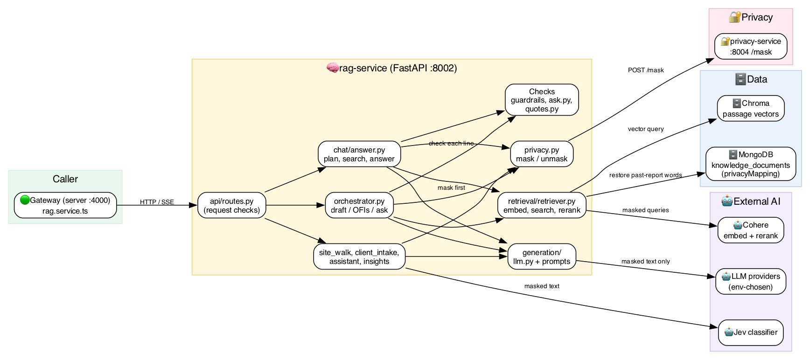

# rag-service (S4)

## What it is

A FastAPI service (port 8002) that finds passages in the knowledge base, drafts cited report text with an LLM, and checks every statement before the gateway saves or shows it.

## Where it sits



- Only the gateway (`server`, `server/src/services/rag.service.ts`) calls it. The browser never does.
- It reads Chroma (passage vectors) and MongoDB (`knowledge_documents.privacyMapping` only). It writes to neither. The gateway saves what it returns.
- Every call to an outside AI (Cohere, the LLM, Jev) goes through `privacy-service` `/mask` first, when the gateway sends `privacy.enabled`. See "Gotchas".

## How it works

The section-draft flow (`POST /sections/draft`, `orchestrator.draft`). Other flows are variations of it.

1. `api/routes.py` checks the request (Pydantic models, `extra="forbid"` on most) and reads the optional `X-Model` header (`model_override.py`).
2. `privacy.session()` opens a masking session. With protection on, `/mask` swaps client details for placeholders such as `[PERSON_1]`. If privacy-service fails, the request fails (no raw fallback).
3. `retrieval/retriever.search()` embeds each query with Cohere (one call) and asks Chroma for the nearest passages, filtered by jurisdiction, facility type and source type.
4. `past_reports.with_real_words()` puts real words back into past-report passages (from Mongo `privacyMapping`) so they can be masked again under this request's own numbering.
5. `retriever.rerank()` re-orders passages with Cohere Rerank. In `draft`, a rerank failure is logged and the vector order is kept.
6. `generation/generator.py` builds the prompt (`sections.json` + `drafting-skill.md` + labelled evidence `O1`, `C1`, `P1`) and `generation/llm.py` calls the model with structured output.
7. The orchestrator unmasks the answer, lays it out in template order, and runs checks: `guardrails/checker.check_citations` (every citation must be a given ID, and `P:` past-report citations never count), plus number and maturity-rank checks for some sections.
8. It returns the draft, cited sources, guardrail result, `usage` (paid calls, for the gateway to price and store) and `provenance`.

Streaming flows (`/chat`, `/assessments/ask`) follow the same shape but send server-sent events, and each line is checked before it is sent (`ask.check_statement`, `chat/answer._check`).

## Folders and key files

The tree below shows where the main folders and files sit; the table explains each.

```text
rag-service/
├── app/
│   ├── main.py                       # FastAPI app
│   ├── api/routes.py                 # all endpoints
│   ├── orchestrator/orchestrator.py  # drafts, OFIs, Ask flow
│   ├── chat/                         # knowledge-base chat
│   ├── retrieval/                    # embed, search, rerank
│   ├── generation/                   # LLM calls, prompts, templates
│   ├── guardrails/checker.py         # citation check
│   ├── privacy.py                    # masking session
│   ├── past_reports.py               # past-report words from Mongo
│   ├── site_walk/                    # site walk proposals
│   ├── client_intake/read.py         # reads client documents
│   ├── client_insights/summary.py    # client insight summary
│   ├── assistant/                    # MarshBot coverage and wording
│   ├── config.py                     # settings from env
│   ├── qdrant_collection.py          # Qdrant as a Chroma collection
│   ├── retrieval_config.py           # VECTOR_STORE switch, clients
│   └── usage.py                      # paid-call usage
├── tests/                            # pytest suite
│   └── conftest.py                   # blocks real network calls
└── eval/                             # scoring scripts (can spend money)
```

| Path | Job |
|---|---|
| `app/main.py` | Creates the FastAPI app, mounts the router, runs `read_model_header` on every request. |
| `app/api/routes.py` | All endpoints and their request models. |
| `app/orchestrator/orchestrator.py` | Section draft, OFIs, summary, checklist, and the Ask flow (`ask`, `ask_events`). |
| `app/chat/` | Knowledge-base chat (`answer.py`), quote check (`quotes.py`), passage lookup for the citation panel (`passages.py`). |
| `app/retrieval/` | Cohere embed, Chroma query, rerank (`retriever.py`); keyword search (`keyword_search.py`); source-tier order (`ranking.py`); abbreviation expansion (`glossary.py`). |
| `app/generation/` | LLM calls (`llm.py`), section/OFI/summary prompts (`generator.py`), Ask and proposed-text rules (`ask.py`, `propose.py`), checklist, figure proposals (`proposals.py`). |
| `app/generation/*-skill.md`, `*.json` | Prompt text and templates the code reads at runtime. Treat them as code. |
| `app/guardrails/checker.py` | `check_citations`. `check` is a stub. |
| `app/privacy.py` | Masking session: mask, unmask, streamed unmask, fail closed. |
| `app/past_reports.py` | Restores past-report words from Mongo. |
| `app/site_walk/` | Site walk proposal (`propose.py`), shorthand note split (`note_split.py`), Jev classifier adapter (`jev.py`). |
| `app/client_intake/read.py` | Reads client documents (CP-23). |
| `app/client_insights/summary.py` | Client insight summary (CP-29). |
| `app/assistant/` | MarshBot coverage check and wording (AS-06). |
| `app/config.py`, `app/retrieval_config.py` | Settings from env vars; Cohere, Chroma and Qdrant clients; the `VECTOR_STORE` switch. |
| `app/qdrant_collection.py` | Qdrant answering Chroma's collection calls (QD-01); identical copy in ingestion-service. |
| `app/usage.py` | Collects paid-call usage per request. |
| `tests/` | 49 test files. `tests/conftest.py` blocks real network calls. |
| `eval/` | Scoring scripts and cases (chat, site walk, intake, OFIs). These can spend money. |

## Endpoints

| Method and path | What it does | Who calls it |
|---|---|---|
| `GET /health` | Returns `{"status":"ok"}`. | Health checks (not verified who). |
| `GET /sections` | Template sections and what each needs. | Gateway |
| `POST /sections/draft` | Drafts one section. 502 on model failure. | Gateway |
| `POST /ofis/draft` | Drafts Section 3 OFIs. | Gateway |
| `POST /summary/draft` | Drafts the Executive Summary. | Gateway |
| `POST /figures/propose` | Proposes Section 4 scores or Section 5 inputs. Not masked. | Gateway |
| `POST /checklist/draft` | Pre-survey checklist. | Gateway |
| `POST /site-walks/propose` | Reads a site walk into observations. | Gateway |
| `POST /client-intakes/read` | Reads client documents. | Gateway |
| `POST /client-insights/summary` | Checked summary for a client. | Gateway |
| `POST /split-note` | Splits a shorthand note into parts. | Gateway |
| `POST /assistant/coverage`, `/assistant/wording` | MarshBot checks and wording. | Gateway |
| `POST /chat` | Streams a cited chat answer (SSE). | Gateway |
| `POST /assessments/ask` | Streams an Ask answer, passage question or text proposal (SSE). | Gateway |
| `POST /passages/search` | Keyword search in given documents (no external call). | Gateway |
| `POST /passages/meaning` | Meaning search in one document (Cohere). | Gateway |
| `GET /passages/{id}` | One passage and its page boxes. | Gateway |
| `POST /retrieve` | Raw retrieval, no masking. | Tests and eval harness (the gateway does not call it). |
| `POST /generate` | Stub. Returns placeholder text. | Nobody useful (the gateway's own `/generate` is also a stub). |

## Data it reads and writes

| Store | Access | What |
|---|---|---|
| Chroma | read | Collection `{CHROMA_COLLECTION}_{EMBEDDING_MODEL}_1024`. Written by ingestion-service. |
| MongoDB | read | `knowledge_documents` (field `privacyMapping`) via `MONGODB_URI`. |
| Cohere | call | Embed and rerank. |
| LLM providers | call | Anthropic and OpenAI are wired in `generation/llm.py`. |
| TypeSafe Jev | call | Fixed-choice classifier (`site_walk/jev.py`). |
| privacy-service | call | `POST /mask`. |

It writes nothing to MongoDB or Chroma. Paid calls come back in `usage` for the gateway to store in `ai_calls`.

## Configuration

Names only. See `app/config.py`, `app/retrieval_config.py` and the root `.env.example`.

- Provider and models: `LLM_PROVIDER`, `LLM_MODEL`, `LLM_EFFORT`, `CHAT_PROVIDER`, `CHAT_MODEL`, `CHAT_EFFORT`, `CHAT_PLAN_PROVIDER`, `CHAT_PLAN_MODEL`.
- Per-feature model and effort: `ASK_MODEL`, `ASK_EFFORT`, `PROPOSE_EFFORT`, `INSIGHTS_MODEL`, `INSIGHTS_EFFORT`, `CHECKLIST_EFFORT`, `SITE_WALK_MODEL`, `SITE_WALK_EFFORT`, `CLIENT_INTAKE_MODEL`, `CLIENT_INTAKE_EFFORT`, `ASSISTANT_COVERAGE_MODEL`, `ASSISTANT_COVERAGE_EFFORT`, `ASSISTANT_WORDING_MODEL`, `ASSISTANT_WORDING_EFFORT`, `SPLIT_NOTE_MODEL`, `SPLIT_NOTE_EFFORT`.
- Cut-offs: `ASK_MIN_RELEVANCE`, `CHAT_MIN_RELEVANCE`.
- Classifiers: `SITE_WALK_CLASSIFIER`, `CLIENT_INTAKE_CLASSIFIER`, `TYPESAFE_API_KEY`.
- Keys: `ANTHROPIC_API_KEY`, `OPENAI_CHAT_API_KEY` (not `OPENAI_API_KEY`, which is a Groq key for Whisper), `COHERE_API_KEY`.
- Retrieval: `EMBEDDING_MODEL`, `RERANK_MODEL`, `CHROMA_MODE`, `CHROMA_COLLECTION`, `CHROMA_HOST`, `CHROMA_PORT`, `CHROMA_API_KEY`, `CHROMA_TENANT`, `CHROMA_DATABASE`, `CHROMA_CLOUD_HOST`.
- Other: `MONGODB_URI`, `PRIVACY_SERVICE_URL`, `PRIVACY_TIMEOUT`, `CLIENT_INTAKE_PRIVACY_TIMEOUT`.
- The gateway chooses whether masking is on, per request. This service never reads `PII_PROTECTION`.

## Run and test

From `microservices/rag-service` (commands match `.github/workflows/github_action_test.yml` and the root README):

```sh
uv sync --locked                                  # install from uv.lock
uvicorn app.main:app --reload --port 8002         # run locally
uv run ruff check . && uv run ruff format --check .   # lint (CI runs both)
uv run pytest -q --tb=short                       # tests (mocked, no paid calls)
```

- With Docker, the service is `rag-service` in the root `docker-compose.yml`, and `./microservices/rag-service` is mounted over `/app`.
- Eval scripts (for example `uv run --extra dev python -m eval.chat_eval <command>`) call real paid APIs. Do not run them casually.

## Gotchas

- Never hardcode a provider name. `LLM_PROVIDER` and the `CHAT_*` settings pick it. (`llm.py` still has "anthropic" and "openai" in its lookup tables and usage labels.)
- `LLM_PROVIDER` is used by drafting, OFIs, Ask, summaries and site-walk reading. Chat uses `CHAT_PROVIDER`. `X-Model` changes only the model, never the provider.
- Mask before the call, unmask before any check or save, fail closed. Never send raw text as a fallback. `POST /figures/propose` is a known exception (see privacy docs).
- `app/generation/drafting-skill.md` and `ofi-skill.md` are runtime prompts. Editing them changes output. Bump the matching prompt version constant when you change a prompt (for example `PROMPT_VERSION` in `chat/answer.py`).
- `answer_components.txt` and `marshbot_components.txt` are generated from the client's library (see the comments in `chat/answer.py`). The client's tests rewrite them.
- The Cohere trial key allows few calls a minute, so `retriever._with_retries` waits and retries, and drafting batches searches. Keep searches batched.
- `usage.start()` uses a context variable. Streaming flows copy the context (`ask_events`, `answer_events`). Without this the usage list is lost.
- `docker-compose.yml` mounts `microservices/rag-service/app` read-only into the `client` container, because two client tests read files from here.
- `Dockerfile` starts uvicorn with `--reload`.

## Deeper docs

- `docs/areas/services.md`: "Report section drafting (S4, GN-01)", "Opportunities for Improvement (S4, GN-05)", "Pre-survey checklist (S4, CP-30)", "Site walk proposal (S4, CP-22)", "Client intake" (rag-service: `POST /client-intakes/read`), "Client insights summary (S4, gateway, CP-29)", "Asking about an assessment (S4, AS-01)", "Knowledge chat: cost and speed (S4, CB-01)", "Chat retrieval ranking by source tier (RT-04)", "Splitting a shorthand note (CP-35)".
- `docs/areas/privacy.md`: "Protected flows", "How a protected request works", "Known gaps".
- `docs/areas/database.md`: "Knowledge documents (IN-01, KB-01, IN-07)" (the `privacyMapping` field), "AI-call usage (EV-03)".
- `CLAUDE.md`: Hard rules.
