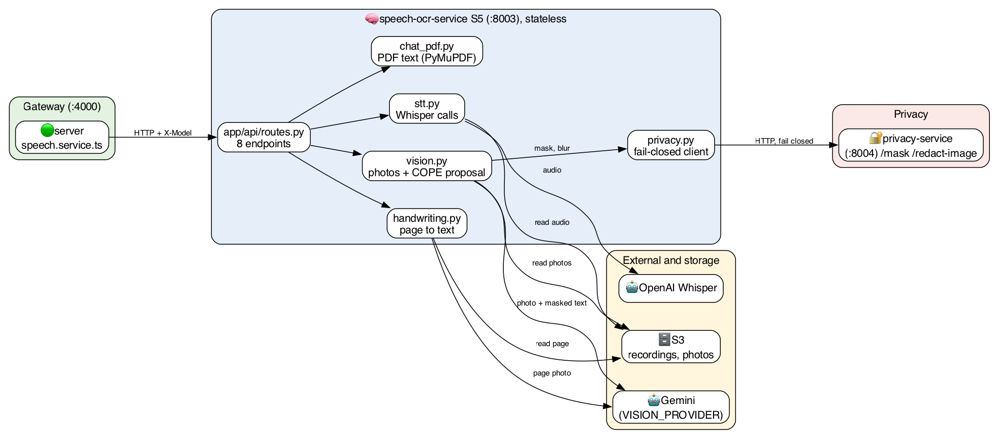

# Speech and OCR service (S5)

A stateless FastAPI service (port `8003`) that turns recordings, handwriting photos, site photos and chat PDFs into text and proposals, and returns them to the gateway.

## Where it sits



- Only the gateway (`server/src/services/speech.service.ts`) calls it, through `SPEECH_OCR_SERVICE_URL`. It never talks to the browser.
- It reads files from S3 (boto3), and calls OpenAI Whisper (speech) and Gemini (photos, handwriting). Before Gemini sees a photo or note text, it calls privacy-service (`/mask`, `/redact-image`).
- It is stateless: it writes nothing to MongoDB (CLAUDE.md hard rule). The gateway stores what S5 returns. A search of `app/` and `pyproject.toml` finds no MongoDB code or driver.

## How it works

1. The gateway posts a request. `app/main.py` first runs `read_model_header` on every request. It copies the `X-Model` header (the admin's model choice, S-01) into a context variable.
2. A route in `app/api/routes.py` validates the body and calls one processor in `app/processors/`.
3. The processor reads the file from S3 (recordings, photos, pages), or takes bytes sent in the request (`/transcribe-clip`, `/chat-pdf/extract`).
4. Photos are made upright and shrunk to 1600 px (`images.py`). Pages are the same.
5. For `/interpret`, `/describe-photo` and `/chat-photo/faces`, `app/privacy.py` calls privacy-service: faces are blurred, and note text is masked when the gateway sent `privacy.enabled`. If privacy-service fails, the call fails (fail closed). Nothing raw is sent instead.
6. The processor calls Whisper or Gemini with `store=False` for Gemini (Google need not keep the request).
7. The answer is checked, details Gemini added are taken out (`check_answers`), and real names are put back (unmask).
8. The route returns JSON, or 502 with a `detail` the gateway shows to the engineer (422 for a bad PDF or bad base64).

## Folders and key files

The tree below shows where the main folders and files sit; the table explains each.

```text
speech-ocr-service/
├── app/
│   ├── main.py             # FastAPI app
│   ├── api/routes.py       # all endpoints
│   ├── config.py           # reads env vars
│   ├── model_override.py   # X-Model header
│   ├── privacy.py          # privacy-service client
│   └── processors/
│       ├── stt.py          # Whisper transcription
│       ├── vision.py       # reads observations, photos
│       ├── handwriting.py  # handwritten page to text
│       ├── chat_pdf.py     # text of each PDF page
│       ├── chat_photo.py   # faces counted, blurred copy
│       └── images.py       # upright, crop, shrink, JPEG
├── eval/                   # paid-API eval scripts
└── tests/                  # pytest suite
    └── conftest.py         # fakes privacy-service
```

| Path | Job |
|---|---|
| `app/main.py` | Creates the FastAPI app, runs `read_model_header` on every request. |
| `app/api/routes.py` | All endpoints and their request models. Turns processor errors into 502 or 422. |
| `app/config.py` | Reads env vars (names below). Loads `.env` with `python-dotenv`. |
| `app/model_override.py` | `X-Model` header into a `ContextVar` (S-01). Only the model changes; the provider always comes from env. |
| `app/privacy.py` | Client for privacy-service: `Session` with `mask`, `check_answer`, `redact_images`, `unmask`. Raises `PrivacyUnavailable`. |
| `app/processors/stt.py` | Whisper transcription (`transcribe` from S3, `transcribe_clip` from bytes). |
| `app/processors/vision.py` | Reads an observation (COPE categories, description, hazard type), describes site and chat photos. Largest file. |
| `app/processors/handwriting.py` | Handwritten page to text, with uncertain words marked (CP-19). |
| `app/processors/chat_pdf.py` | Text of each PDF page with PyMuPDF (CB-09). Text layer only. |
| `app/processors/chat_photo.py` | Counts faces in a chat photo and returns a blurred copy (CB-08). |
| `app/processors/images.py` | Makes a photo upright, crops a marked area, shrinks it, saves JPEG. |
| `eval/` | Paid-API eval scripts and cases (speech, handwriting, photos, categories). Run by hand. |
| `tests/` | pytest tests. `conftest.py` fakes privacy-service in-process. |

## Endpoints

| Method and path | What it does | Who calls it |
|---|---|---|
| `GET /health` | Returns `{status: ok}`. | Not verified (no caller found in `server/src`). |
| `POST /transcribe` | Whisper transcript, timed segments and usage for a recording in S3 (`s3_key`). | Gateway (`speech.service.ts`). |
| `POST /transcribe-clip` | Same for a short spoken chat question sent as base64 (`audio_base64`). Uses a vocabulary hint and drops non-speech pieces. | Gateway (chat). |
| `POST /interpret` | Proposal for one observation: COPE categories with evidence, description, hazard type. Takes photos, texts, location, `parts`, `privacy`. | Gateway (`speech.service.ts`). |
| `POST /describe-photo` | One-to-two sentence description of a site-walk photo (CP-22). Optional `privacy`. | Gateway. |
| `POST /transcribe-handwriting` | Transcript of one handwritten page, with uncertain word positions (CP-19). | Gateway. |
| `POST /chat-pdf/extract` | Text of each page of a chat PDF (max 20 pages). | Gateway. |
| `POST /chat-photo/faces` | Face count and a blurred copy of a chat photo (CB-08). | Gateway. |
| `POST /chat-photo/describe` | Description and "unclear" parts of a chat photo (CB-08). | Gateway. |

## Data it reads and writes

- Reads: S3 objects (recordings, photos, pages) by `s3_key`, in `S3_BUCKET`. Bytes in the request body (clips, PDFs).
- Sends out: audio to OpenAI Whisper; photos, pages and (masked) text to Gemini; text and photos to privacy-service.
- Writes: nothing. No MongoDB, no S3 writes, no files. Each reply carries a `usage` list that the gateway stores (EV-03).

## Configuration

Names only; values live in `.env` (never commit it). See `.env.example`.

- `WHISPER_MODEL`, `OPENAI_API_KEY` (read by the OpenAI SDK).
- `VISION_PROVIDER`, `VISION_MODEL`, `GEMINI_API_KEY`: photo interpretation.
- `HANDWRITING_PROVIDER`, `HANDWRITING_MODEL`: handwriting. Blank means "same as vision".
- `PRIVACY_SERVICE_URL`, `PRIVACY_TIMEOUT` (seconds).
- `S3_BUCKET`, `AWS_REGION`, plus AWS credentials read by boto3.

In Docker, `docker-compose.yml` overrides `PRIVACY_SERVICE_URL` to `http://privacy-service:8004`. S5 never reads `PII_PROTECTION`: the gateway decides and sends `privacy` in the request.

## Run and test

Commands that appear in the repo's docs and Dockerfile:

```bash
# Docker (from the repo root)
docker compose up -d speech-ocr-service

# Local, from microservices/speech-ocr-service (the Dockerfile's command, port 8003)
uv run uvicorn app.main:app --host 0.0.0.0 --port 8003

# Tests (pytest is in the dev extra; pythonpath is set in pyproject.toml)
uv run --extra dev pytest

# An eval (calls a paid API), for example handwriting
uv run --extra dev python -m eval.transcribe_handwriting
```

The `pytest` line follows the `uv run --extra dev python -m ...` pattern in `docs/areas/services.md` (not run for this README).

## Gotchas

- Handwriting and Whisper audio cannot be masked. They go out as recorded (a decision, see `docs/areas/privacy.md`, "Known gaps").
- Error text starting with "The recording could not be read from storage", "The photo could not be read from storage" and "The page could not be read from storage" is matched by the gateway (`server/src/services/observation.service.ts`). Change the words in both places.
- `read_model_header` must stay `async`. A sync dependency runs in another thread and the value is lost.
- `VISION_PROVIDER` or `HANDWRITING_PROVIDER` set to anything but `gemini` raises an error. `/interpret` raises `NotImplementedError`, which the route does not catch (HTTP 500, not 502).
- The `Dockerfile` command includes `--reload`, a development flag.
- `TYPES` and the placeholder regex in `app/privacy.py` are copied from privacy-service. Keep them in step.
- Bump `PROMPT_VERSION` in `vision.py` or `handwriting.py` when prompt wording changes.

## Deeper docs

- `docs/areas/services.md`: "Speech (S5) and voice transcription (CP-03)", "Reading an observation (S5, CP-05, CP-21)", "Handwritten pages (S5, CP-19)".
- `docs/areas/privacy.md`: "Protected flows", "Observation reading (PV-04)", "Known gaps".
- `microservices/privacy-service/README.md`: the service S5 calls for masking and face blur.
