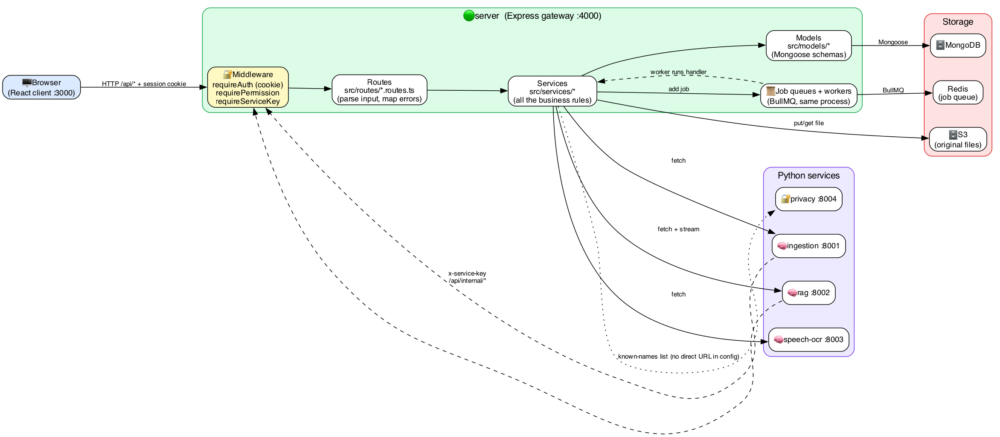

# server (API gateway)

## What it is

The Express + TypeScript gateway (port 4000) that signs users in, owns the MongoDB data, stores files in S3, runs background jobs, and calls the Python services.

## Where it sits

- The browser (client, :3000) only ever talks to this service, under `/api/*`.
- It calls ingestion (:8001), rag (:8002) and speech-ocr (:8003) over HTTP (`fetch`). Their URLs come from `INGESTION_SERVICE_URL`, `RAG_SERVICE_URL`, `SPEECH_OCR_SERVICE_URL` (`src/config.ts`). There is no `PRIVACY_SERVICE_URL` in `config.ts`: the gateway builds the list of known client/site/person names (`services/privacy.service.ts`) and the masking call itself is made elsewhere (not verified where).
- Python services call back on `/api/internal/*` with an `x-service-key` header (notifications, AI usage, knowledge-document privacy).

## How a request flows

1. `src/index.ts` mounts each router under a path, with `requireAuth` in front (`middleware/auth.middleware.ts`). No cookie or a bad one gives 401.
2. A route file (`src/routes/*.routes.ts`) names `requirePermission('<permission>')` on each handler. A role without it gets 403.
3. The handler parses the body, calls a function in `src/services/`, and turns known error classes into 400/403/404/409/503.
4. The service holds the rules and talks to Mongo through `src/models/` (Mongoose), S3 (`storage.service.ts`), the queues, or a Python service.
5. The handler replies with JSON (or a stream, for chat and ask).
6. A final error handler in `index.ts` turns `ModelUnavailableError` into 503; anything else goes to Express's default handler.

Hard rule (CLAUDE.md): route files must not import from `models/`. Today `routes/chat.routes.ts` does (it imports `ChatMessageModel`); the other 30 route files do not.

## Folders and key files

| Path                                  | Job                                                                                                                                                          |
| ------------------------------------- | ------------------------------------------------------------------------------------------------------------------------------------------------------------ |
| `src/index.ts`                        | Builds the app, mounts routers, sets body limits, runs startup recovery, `listen`                                                                            |
| `src/config.ts`                       | Reads env once; throws at boot if a required var is missing                                                                                                  |
| `src/routes/`                         | 31 files: one router per area; thin handlers                                                                                                                 |
| `src/middleware/`                     | `auth.middleware.ts` (session + permission), `service-auth.middleware.ts` (shared key), `assistant-recheck.middleware.ts` (MarshBot re-check after a change) |
| `src/services/`                       | Business logic. Biggest: `observation.service.ts`, `knowledge-document.service.ts`, `usage-report.service.ts`, `assessment-ask.service.ts`                   |
| `src/services/assistant/`             | MarshBot: brief, checks, stage, server-sent-events bus, daily check queue                                                                                    |
| `src/services/generation/`            | Background drafting runs (GN-13)                                                                                                                             |
| `src/services/job-queue.service.ts`   | `defineQueue` + `startWorkers` (BullMQ wrapper)                                                                                                              |
| `src/services/permissions.service.ts` | The role-to-permission matrix                                                                                                                                |
| `src/services/storage.service.ts`     | S3 put/get/copy/delete                                                                                                                                       |
| `src/models/`                         | 38 Mongoose model files, plus `db.ts` (connect + index setup)                                                                                                |
| `src/scripts/`                        | Seeds and one-off migrations (run through `npm run seed:*`, `migrate:*`)                                                                                     |
| `src/test/`                           | 100+ Vitest files, in-memory Mongo                                                                                                                           |

## API map

All under `/api` (see the `app.use` lines in `src/index.ts`).

| Group                                                        | What it does                                                                                                                            |
| ------------------------------------------------------------ | --------------------------------------------------------------------------------------------------------------------------------------- |
| `/auth`                                                      | Login, logout, `me`, password reset, accept invitation (public)                                                                         |
| `/users`                                                     | Accounts, roles, invitations (`users:manage`)                                                                                           |
| `/assessments`                                               | Assessments, sections, review, export, reassign; sub-routers for site-walks, comments, ask, proposals, assistant (MarshBot), generation |
| `/observations`                                              | Edit observations, recordings, photos, pages                                                                                            |
| `/clients`, `/sites`, `/client-intakes`, `/client-documents` | Client data, sites, intake reading, kept client files                                                                                   |
| `/knowledge-documents`, `/knowledge-gaps`                    | Standards library and requests for missing ones                                                                                         |
| `/rag`, `/qa`                                                | Draft report text and quality check (calls rag-service)                                                                                 |
| `/chat`                                                      | Knowledge chat (conversations, photos, PDFs, memory, voice)                                                                             |
| `/settings`                                                  | Models, global defaults, per-user preferences                                                                                           |
| `/usage`                                                     | Usage and cost report, CSV export                                                                                                       |
| `/notifications`                                             | Inbox, plus a poll-only `count` path that does not refresh the session                                                                  |
| `/internal/*`                                                | Service-to-service (shared key, no session)                                                                                             |
| `/health`                                                    | Public health check                                                                                                                     |

## Data it owns

Collection names from `src/models/*`. Schemas: `docs/areas/database.md`.

- `users`, `app_settings`, `user_settings`, `settings_log`: accounts and settings
- `assessments`, `capture_sessions`, `observations`, `site_walks`: the survey and its notes
- `clients`, `sites`, `client_intakes` (temporary), `client_documents`, `client_insight_summaries`
- `report_sections`, `report_section_versions` (append-only), `review_audit_log` (append-only), `report_comment_threads`, `report_text_proposals`, `report_ofis`, `drafting_runs`
- `assistant_conversations` (Ask), `assistant_briefs`, `assistant_threads`, `assistant_activity`, `assistant_viewers`: Ask and MarshBot
- `knowledge_documents`, `manual_sections`, `ingestion_jobs`, `knowledge_gap_requests`
- `checklists`, `notifications`, `ai_calls` (usage and cost), `counters`
- Chat models (`chat-*.model.ts`) also exist; their collection names are not listed here (not verified).

## Background work

BullMQ on Redis, worked inside the gateway process (`services/job-queue.service.ts`; workers start from `startWorkers()` in `index.ts`). Under `NODE_ENV=test` jobs run inline, no Redis.

| Queue                | Defined in                         | For                                                                             |
| -------------------- | ---------------------------------- | ------------------------------------------------------------------------------- |
| `transcription`      | `background-queues.service.ts`     | Voice notes and site-walk audio                                                 |
| `site-walk-proposal` | `background-queues.service.ts`     | Building a walk's proposal                                                      |
| coverage queue       | `assistant/coverage.service.ts`    | MarshBot coverage                                                               |
| check queue          | `assistant/check-queue.service.ts` | MarshBot re-check and daily check                                               |
| cleanup queue        | `client-intake.service.ts`         | Daily client-intake cleanup                                                     |
| ingestion queue      | `ingestion-queue.service.ts`       | Own `new Queue`, not via `defineQueue`; the Python ingestion worker consumes it |

On boot, `index.ts` also resumes work that a restart interrupted: drafting runs, transcriptions, site walks, interpretations.

## Roles and permissions

- Two roles: `risk_engineer` and `knowledge_admin` (`models/user.model.ts`).
- 12 permissions in `permissions.service.ts` (`assessments:view|edit|assign`, `reports:generate|export|comment|ask`, `knowledge:view|manage`, `users:manage`, `usage:view`, `settings:manage`).
- `requirePermission(p)` runs after `requireAuth`, reads `res.locals.user`, and answers 401 (no user) or 403 (role lacks `p`).
- Many actions also need the assessment's assigned engineer; that check is in services, not the middleware. An admin is read-only on someone else's assessment.
- A few routes use a router-wide gate (`routes/user.routes.ts` uses `router.use(requirePermission('users:manage'))`); notifications and `PATCH /settings/me` have none (own data).
- Sessions: JWT in an httpOnly cookie, 15-minute inactivity expiry, refreshed on each request except the "NoRefresh" paths (polling, SSE, GET brief/generation).

## Configuration

Names only; see `.env.example`. Required (boot fails without): `MONGODB_URI`, `JWT_SECRET`, `INGESTION_SERVICE_URL`, `RAG_SERVICE_URL`, `SPEECH_OCR_SERVICE_URL`, `AWS_REGION`, `S3_BUCKET`, `REDIS_URL`.

Optional: `PORT`, `CONVERTER_SERVICE_URL`, `SERVICE_API_KEY`, `GOOGLE_MAPS_BROWSER_KEY`, `PII_PROTECTION`, `PII_CHECK_ANSWERS`, `CHROMIUM_PATH`, `REPORT_TIME_ZONE`, `APP_URL`, `SMTP_HOST`, `SMTP_PORT`, `SMTP_USER`, `SMTP_PASS`, `SMTP_FROM`, `COHERE_KEY_TIER`, `COHERE_EMBED_USD_PER_1M_TOKENS`, `COHERE_RERANK_USD_PER_1K_SEARCHES`. AWS keys are read by the AWS SDK itself.

The `.env` is the one at the repo root (`config.ts` resolves `../../.env`).

## Run and test

From `server/` (scripts in `package.json`):

- `npm run dev`: start with auto-restart (`ts-node-dev`)
- `npm run build` then `npm start`: compile with `tsc`, run `dist/index.js`
- `npm test`: `vitest run` (one file at a time, in-memory Mongo, no real AI calls)
- `npm run lint` / `npm run format`: ESLint / Prettier
- `npm run seed` (`-- --reset` to empty everything but the knowledge base first), `seed:all` (same), `seed:cp23`, `seed:cp29`, `seed:gn01`, `seed:case`: demo data
- `npm run migrate:*`: one-off data migrations

## Gotchas

- Docker vs local URLs: `*_SERVICE_URL` defaults to `localhost`; `docker-compose.yml` overrides them. A new URL var needs the override too (CLAUDE.md).
- Body limits are per path in `index.ts` (1 MB document save, 5 MB walk proposal, 64 MB export). A new large POST gets 413 until you add one.
- Mount order matters: specific paths (`/assessments/:reference/site-walks`, `.../assistant/events`) are mounted before `/assessments`.
- Polling and SSE routes use `requireAuthNoRefresh` on purpose; do not swap in `requireAuth` or an idle tab never signs out. Do not add polling for MarshBot.
- Login lockout and the logout revoked-token list are in memory (`auth.service.ts`), so a restart clears them and a second instance would not share them.
- `review_audit_log` and `report_section_versions` are append-only; `stage` only moves via `advanceStage`.
- Tests point service URLs at a closed port so a missing mock fails instead of spending money.
- Route files import from services only (rule above); `chat.routes.ts` is the current exception.

## Deeper docs

- `docs/areas/database.md`: "Role permissions (F-05)", "Report sections (GN-01)", "Review audit log (RV-02)", "Report section versions (RV-08, RV-06)", "Ask conversations (AS-01, AS-03)", "Notifications", "AI-call usage (EV-03)"
- `docs/areas/services.md`: "Report section drafting (S4, GN-01)", "Background drafting (GN-13)", "Asking about an assessment (S4, AS-01)", "Report export (S2, EX-01)", "Assessment assistant (MarshBot, AS-06)", "Who is told what (F-10, RV-11)", "Idle sign-out (F-07)", "Knowledge document ingestion (IN-01)"
- `docs/areas/privacy.md`: masking before external AI calls
- `CLAUDE.md`: hard rules
